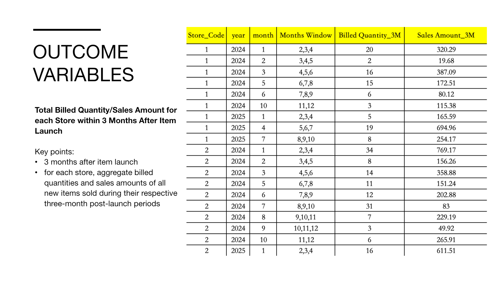
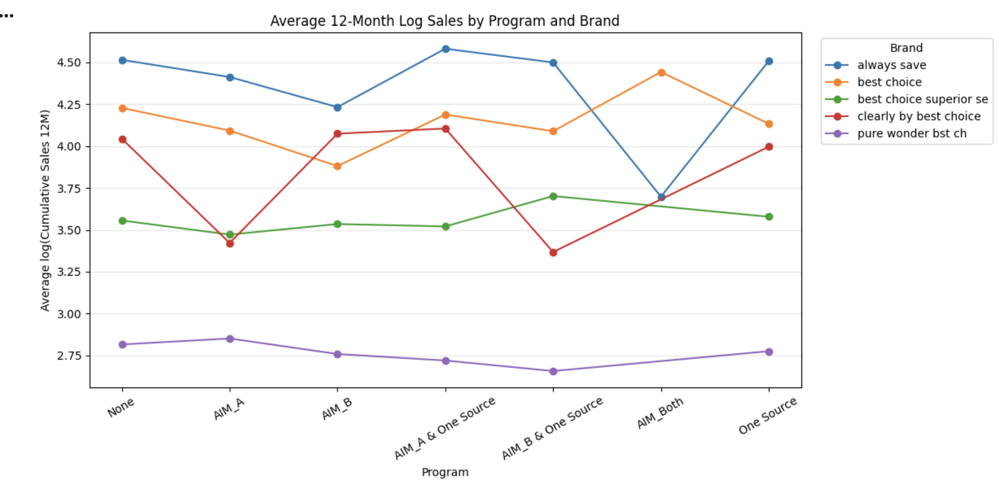

# AWG Retail Program Participation Analysis

English | [简体中文](README.zh-CN.md)

A retail program analysis for AWG, completed as a **UIUC BADM550 client project**.

**Python · pandas · NumPy · statsmodels · Matplotlib · seaborn · Excel**

## Project at a glance

- **Background:** AWG supports new-item launches through AIM auto-ship and One Source in-store merchandising.
- **Data:** **540K+ monthly sales records**, alongside store participation lists, product attributes, and launch dates.
- **Business question:** How do new-item purchasing and store coverage differ across participation groups, and how do these patterns vary by **brand and division**?

## My contributions

- **Data preparation:** Reshaped, cleaned, fuzzy-matched, and integrated **540K+ raw records**, establishing **store × item × month** as the base analytical grain. [Code](notebooks/01_checkpoint1_data_and_metrics.ipynb)
- **KPI development · Checkpoint 1:** Framed new-item performance comparisons across program groups; used Python to calculate **three-month cumulative sales and billed quantity by store × launch cohort**, plus **item-level store coverage**. [Code](notebooks/01_checkpoint1_data_and_metrics.ipynb)
- **Regression analysis · Checkpoint 2:** Built **program × brand OLS interaction models** in Python and visualized cumulative sales patterns across **5 brands** and participation groups. [Code](notebooks/02_checkpoint2_brand_and_division.ipynb)
- **Client presentations:** Created and presented slides covering KPI design, regression methods, and brand findings across both checkpoints. [Checkpoint 1: slides 3–7](presentations/checkpoint-1-client-presentation.pptx) · [Checkpoint 2: slides 17–19](presentations/checkpoint-2-client-presentation.pptx)

## Key findings

- Stores enrolled in both programs had the **highest mean early sales per store** in the first-checkpoint comparison.
- Brand and division profiles identified distinct program patterns, informing **brand-specific recommendations and regional pilot priorities** presented across two client briefings.

**KPI design — Checkpoint 1, slide 5**

**Brand comparisons — Checkpoint 2, slide 19**

## Explore the project

| Content | Files |
|---|---|
| Data preparation and KPIs | [Checkpoint 1 notebook](notebooks/01_checkpoint1_data_and_metrics.ipynb) · [Metric definitions](docs/methodology.md) |
| Brand and division analysis | [Checkpoint 2 notebook](notebooks/02_checkpoint2_brand_and_division.ipynb) · [Complete findings](docs/checkpoint-2.md) |
| Client deliverables | [Two complete presentations](presentations/README.md) · [Original chart gallery](reports/presentation-excerpts/README.md) |

Client workbooks are stored locally. Follow the [execution guide](docs/reproducibility.md) for setup and required inputs.

[Case study](docs/case-study.md) · [Project deliverables](docs/project-deliverables.md) · [Original code archive](notebooks/archive/README.md) · [License](LICENSE) · [Attribution](NOTICE.md)
