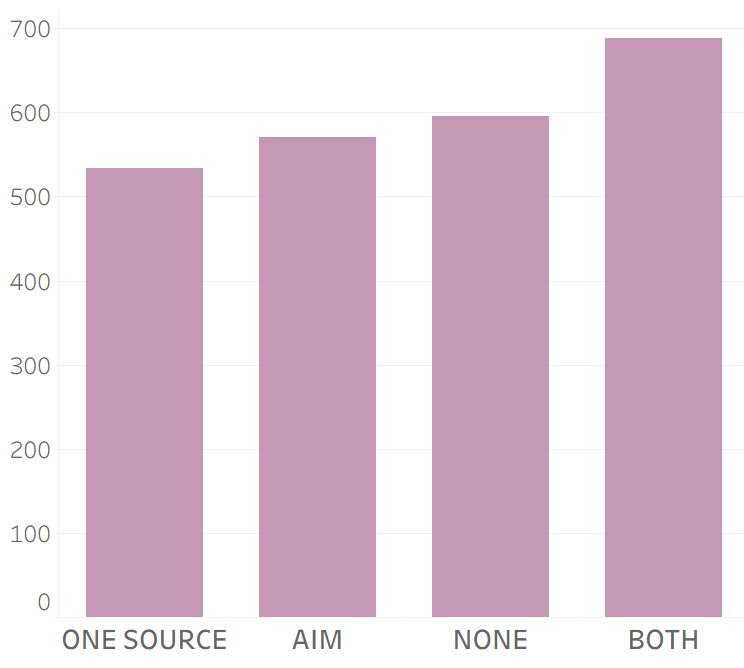
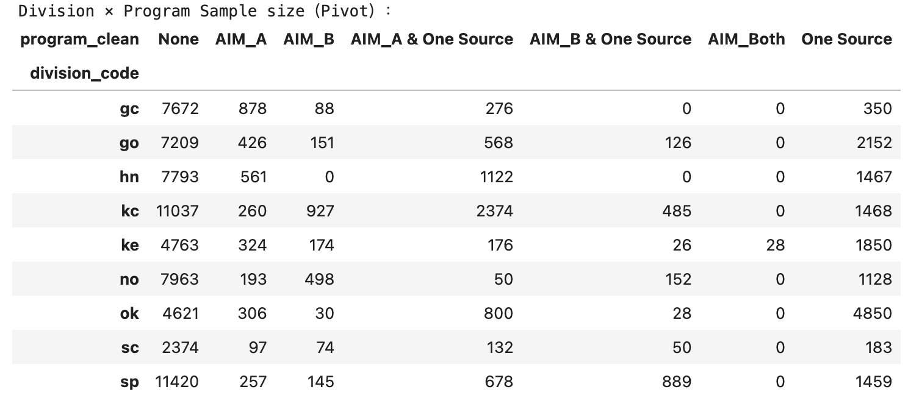
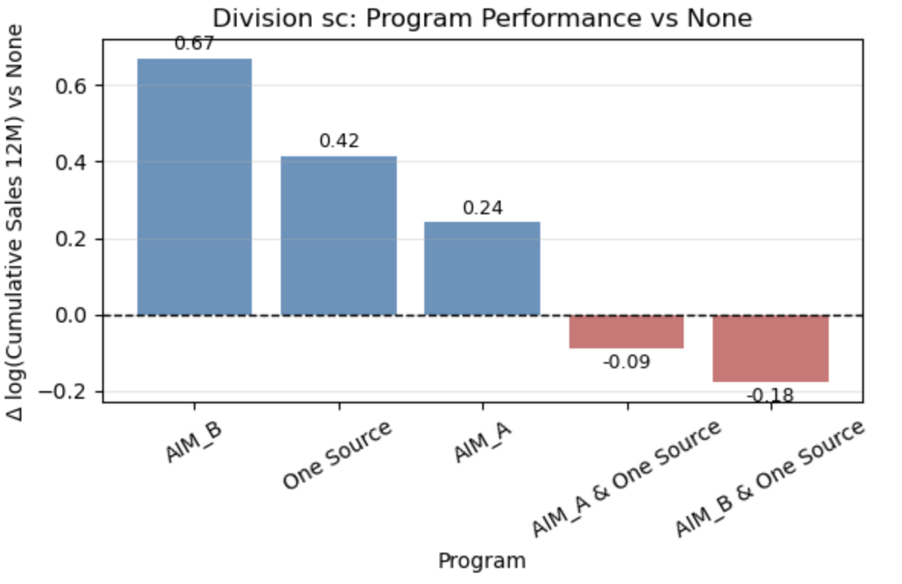

# AWG Retail Program Participation Analysis

**English** / [简体中文](README.zh-CN.md)

A **UIUC BADM550 client analytics project** evaluating new-item purchasing and adoption across AIM auto-ship and One Source merchandising participation groups.

**Data preparation:** 542,564 monthly source records.  
**Regression analysis:** 93,108 store-item observations, 2,736 stores, 185 items, 5 brands, and 9 divisions.

**Stack:** Python · pandas · NumPy · statsmodels · Matplotlib · seaborn · Excel  
**Skills:** Data cleaning and joins · KPI design · Exploratory analysis · OLS interaction regression · Client communication

**Delivered:** Integrated analytical tables, launch-window KPIs, brand/division regression findings, and two client presentations. [Project work and deliverables](docs/project-deliverables.md)

[Key findings](#key-findings) · [Data and KPI code](notebooks/01_checkpoint1_data_and_metrics.ipynb) · [Regression code](notebooks/02_checkpoint2_brand_and_division.ipynb) · [Client presentations](presentations/README.md)

## Key findings

- **Early performance:** the combined-program group had the highest mean early sales per store in the first-checkpoint comparison.
- **Brand differences:** the five brands displayed distinct participation profiles, supporting brand-specific program evaluation.
- **Regional differences:** nine division comparisons identified standalone and combined-program patterns for targeted follow-up.


The project turns retail sales and participation files into a defined KPI framework, segment comparisons, and client-facing recommendations. [Read the complete case](docs/case-study.md) · [Explore all second-checkpoint findings](docs/checkpoint-2.md)

<details>
<summary>View original early-sales results, brand findings, sample matrix, and all nine divisions</summary>

The first checkpoint established a consistent framework for comparing early sales and adoption. The second checkpoint covered **2,736 stores, 185 items, five brands, and nine divisions**, using **93,108 store-item observations**. The original brand interaction model reports R² of **0.051**, and the division interaction model reports R² of **0.014**. These figures document the original project analysis.

The segment comparisons provide a structured view of program performance across brands and divisions. Distinct-store counts add context to the estimates and help prioritize combinations for further evaluation. Together, the findings support **brand- and division-specific pilot design**, with store characteristics, product mix, and participation timing as the next set of analytical inputs. [Case study](docs/case-study.md) · [Full second-checkpoint findings](docs/checkpoint-2.md)

### Checkpoint 1: early sales comparison

Slide 8 of the first-checkpoint presentation compared average early sales per store across participation groups. Stores enrolled in both programs had the highest mean in this comparison, providing a starting point for the subsequent brand and division analysis.



### Checkpoint 2: brand interaction analysis

Slides 17–19 of the second-checkpoint presentation introduce interaction regression and examine how program associations vary by brand. Slide 19 plots mean log cumulative sales across participation categories for five brands.


| Brand | Original presentation finding |
|---|---|
| Always Save | AIM_A & One Source has the highest displayed mean for this brand |
| Best Choice | AIM_Both forms a prominent peak, motivating additional independent-store sampling |
| Best Choice Superior Selection | AIM_B & One Source has the highest displayed mean for this brand |
| Clearly by Best Choice | Standalone and combined categories form distinct participation profiles |
| Pure Wonder Best Choice | Relatively compact means support evaluation alongside product and merchandising strategy |

### Checkpoint 2: sample structure and nine-division comparison

Slides 20–21 define the regional question and present division-by-program observation counts, establishing the sample context for segment comparisons.



Slides 22–30 compare programs against `None` within each of nine divisions. Values below are rounded log cumulative sales differences labeled in the original charts.

| Division | Original displayed result | Evaluation direction |
|---|---|---|
| sc | AIM_B +0.67; One Source +0.42; AIM_A +0.24 | Standalone execution and independent-store support |
| hn | AIM_A & One Source +0.06; One Source +0.02 | Combined program and merchandising comparison |
| sp | AIM_A & One Source +0.08 | Integrated auto-ship and merchandising pathway |
| ke | AIM_A & One Source about 0.00; One Source −0.03 | Store mix and combined-program profile |
| no | AIM_A & One Source +0.04 | Combination-specific sampling and exposure timing |
| kc | One Source −0.03; AIM_A & One Source −0.04 | Baseline store and product composition |
| go | AIM_A & One Source −0.01; One Source −0.06 | Execution and purchasing profiles |
| gc | AIM_A −0.05; AIM_A & One Source −0.10 | Assortment and store-profile alignment |
| ok | AIM_B & One Source +0.50 | Additional participating stores and matched evaluation |

The sc chart from slide 22 is shown below. All nine original regional charts and their interpretation are included in the [full second-checkpoint report](docs/checkpoint-2.md#4-nine-division-summary).



### Checkpoint 2: recommendations and decision use

The brand-fit and regional-allocation themes on slide 31 lead to three evaluation priorities:

- **Match participation to brands.** Combine brand profiles with product strategy to evaluate specific brand-program pairings.
- **Set division-specific pilot candidates.** Use within-division differences, independent-store support, and execution context together.
- **Connect purchasing to operating outcomes.** Track first shipment, repeat purchase, purchase-based distribution, and program costs.

Charts in this section are original client-presentation assets. The [chart gallery](reports/presentation-excerpts/README.md) records their sources. The [full second-checkpoint report](docs/checkpoint-2.md) covers the method, brand findings, sample structure, all nine regional charts, and follow-up tasks.

</details>

## How the analysis works

1. **Prepare the data.** Align identifiers and join store participation, product, launch, and monthly sales records at store × item × month grain.
2. **Build business KPIs.** Define launch-window sales, billed quantity, and purchase-based store coverage with explicit windows and denominators.
3. **Analyze segment differences.** Estimate separate OLS program × brand and program × division interactions using `log(1 + cumulative m12 sales)` and the `None` participation reference.
4. **Communicate decision use.** Combine program profiles, sample structure, and client discussions into brand/division evaluation priorities.

```text
log(1 + sales_m12) ~ C(program) * C(brand)
log(1 + sales_m12) ~ C(program) * C(division)
```

[Metric definitions and regression method](docs/methodology.md) · [Data dictionary](docs/data-dictionary.md)

## Evidence and deliverables

| What to review | Project evidence |
|---|---|
| Data preparation and KPI calculations | [Checkpoint 1 notebook](notebooks/01_checkpoint1_data_and_metrics.ipynb) |
| OLS interactions and analytical plots | [Checkpoint 2 notebook](notebooks/02_checkpoint2_brand_and_division.ipynb) |
| Business findings and recommendations | [Second-checkpoint report](docs/checkpoint-2.md), [complete presentations](presentations/README.md) |
| Project work and analytical history | [Deliverables](docs/project-deliverables.md), [original code archive](notebooks/archive/README.md), [source map](docs/source-map.md) |

## Local execution and project structure

Client workbooks are stored locally. The [execution guide](docs/reproducibility.md) covers required files, environment setup, and notebook execution. The repository includes both complete PPTX presentations, original source archives, execution editions, supplementary Python modules, and validation checks.

[Notebook guide](notebooks/README.md) · [Execution changes](docs/notebook-changes.md) · [Supplementary implementation](src/awg_analysis) · [Chart provenance](reports/presentation-excerpts/README.md)

The [MIT license](LICENSE) covers newly authored supplementary code and documentation; original materials retain their respective rights. [Attribution](NOTICE.md)
