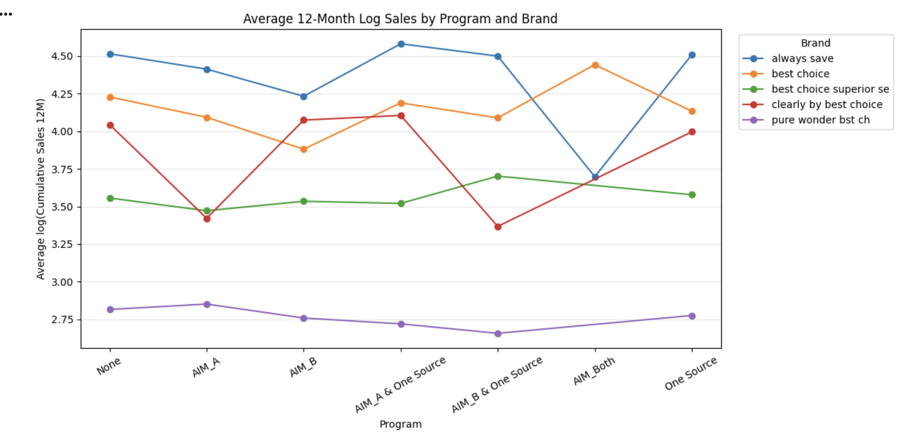
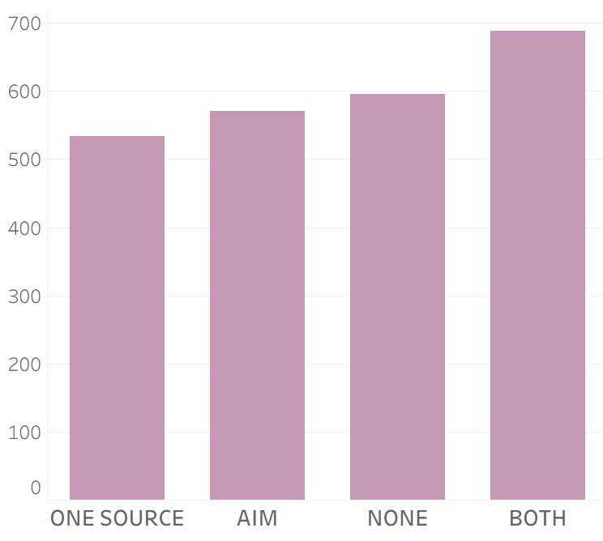
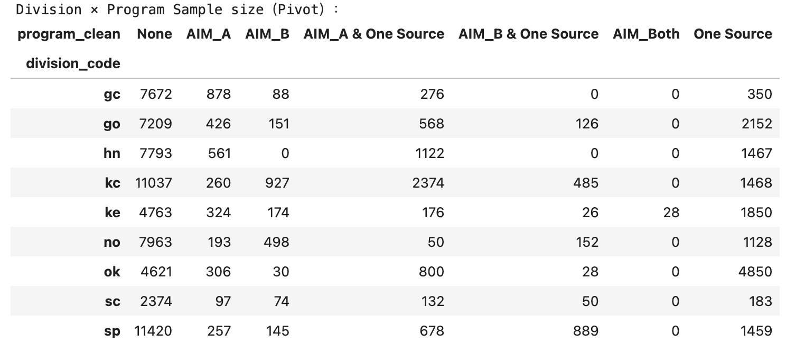
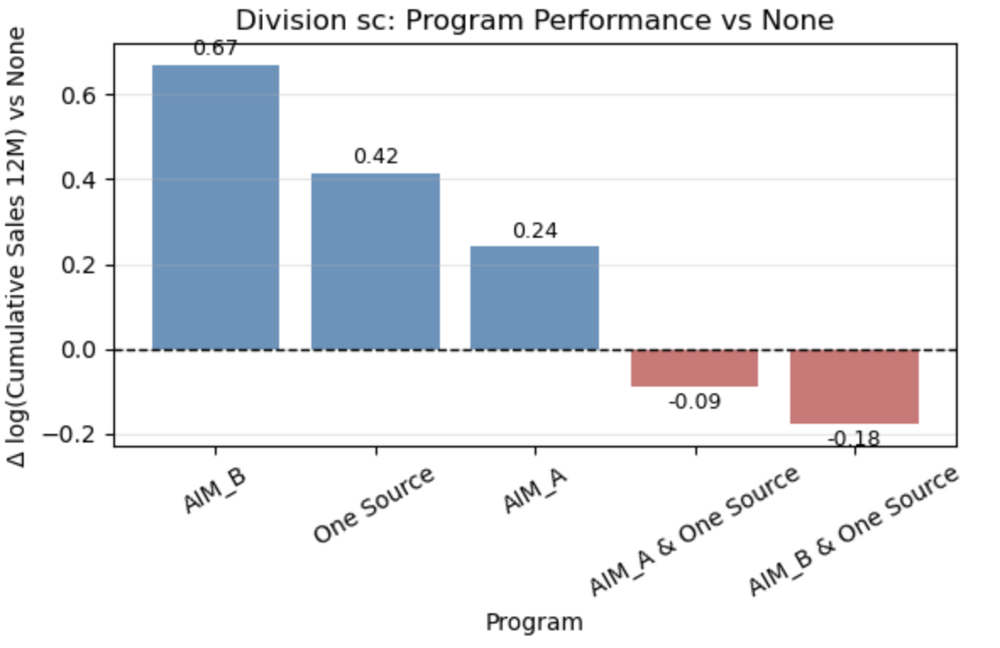

# AWG 零售项目参与分析

[English](README.md) / **简体中文**

本项目是 **UIUC BADM550 的客户分析项目**，评估 AIM 自动配货与 One Source 陈列支持参与组的新品采购与铺货表现。

**数据处理规模：**54.3万条月度源记录。  
**回归分析规模：**93,108条门店商品观测，覆盖2,736家门店、185个商品、5个品牌和9个区域。

**技术栈：**Python · pandas · NumPy · statsmodels · Matplotlib · seaborn · Excel  
**核心能力：**数据清洗与多表关联 · 业务指标设计 · 探索分析 · OLS交互回归 · 客户沟通

**项目交付：**整合分析数据表、上市窗口指标、品牌与区域回归成果，以及两轮客户汇报。[项目工作与交付物](docs/project-deliverables.md)

[关键发现](#关键发现) · [数据与指标代码](notebooks/01_checkpoint1_data_and_metrics.ipynb) · [回归代码](notebooks/02_checkpoint2_brand_and_division.ipynb) · [完整客户汇报](presentations/README.md)

## 关键发现

- **早期表现：**第一轮比较中，同时参与两项项目的门店组，每店平均早期销售额排名最高。
- **品牌差异：**5个品牌呈现各自的项目参与曲线，为品牌定向评估提供依据。
- **区域差异：**9个区域的组内比较形成单项目与组合项目的细分画像，支持后续试点筛选。



项目将销售和参与名单转化为清晰的指标框架、细分比较与客户建议。[完整案例](docs/case-study.md) · [第二轮全部成果](docs/checkpoint-2.zh-CN.md)

<details>
<summary>展开原项目早期销售、品牌发现、样本矩阵与九区域结果</summary>

第一轮建立了比较早期销售与铺货表现的统一框架。第二轮覆盖 **2,736家门店、185个商品、5个品牌和9个区域**，使用 **93,108条门店 × 商品观测**。原项目品牌交互模型 R² 为 **0.051**，区域交互模型 R² 为 **0.014**，对应原分析 notebook 中保存的结果。

细分分析形成了不同品牌和区域的项目表现画像。独立门店数量为各组合的估计结果提供样本背景，帮助确定值得进一步评估的方向。项目成果支持**分品牌、分区域设计试点**，并将门店特征、商品结构和参与时间纳入下一阶段分析。[完整案例](docs/case-study.md) · [第二轮完整成果](docs/checkpoint-2.zh-CN.md)

### 第一轮 checkpoint：早期销售比较

第一轮客户汇报第8页比较了各参与组的每店平均早期销售额，同时参与两项项目的门店组在该项指标中排名最高。这一分组结果为后续品牌与区域分析提供了进一步研究的方向。



### 第二轮 checkpoint：品牌交互分析

第二轮汇报第17–19页通过交互回归和品牌曲线，研究项目与销售的关联如何随品牌变化。第19页呈现5个品牌在各参与类别下的累计销售对数均值。


| 品牌 | 原汇报中的分析线索 |
|---|---|
| Always Save | AIM_A & One Source 对应该品牌曲线的最高均值 |
| Best Choice | AIM_Both 呈现明显峰值，对应后续扩充独立门店样本的评估方向 |
| Best Choice Superior Selection | AIM_B & One Source 对应该品牌曲线的最高均值 |
| Clearly by Best Choice | 单项目与组合项目形成各自的参与表现轨迹 |
| Pure Wonder Best Choice | 各参与类别的均值分布相对集中，适合结合产品与陈列策略评估 |

### 第二轮 checkpoint：区域样本与九区域比较

第二轮汇报第20–21页明确区域分析问题，并展示区域 × 项目类别的观测数，为细分比较提供样本背景。



第22–30页分别比较9个区域内各项目相对 `None` 的表现。以下数值为原图标注的对数累计销售差值。

| 区域 | 原图呈现的结果 | 分析与评估方向 |
|---|---|---|
| sc | AIM_B +0.67；One Source +0.42；AIM_A +0.24 | 单项目执行与独立门店样本 |
| hn | AIM_A & One Source +0.06；One Source +0.02 | 组合项目与陈列支持比较 |
| sp | AIM_A & One Source +0.08 | 自动配货与陈列支持整合 |
| ke | AIM_A & One Source 约0.00；One Source −0.03 | 门店结构与组合项目特征 |
| no | AIM_A & One Source +0.04 | 组合专项样本与参与时间 |
| kc | One Source −0.03；AIM_A & One Source −0.04 | 基准门店与商品结构 |
| go | AIM_A & One Source −0.01；One Source −0.06 | 执行差异与采购画像 |
| gc | AIM_A −0.05；AIM_A & One Source −0.10 | 选品与门店特征对齐 |
| ok | AIM_B & One Source +0.50 | 扩充组合参与门店并开展匹配评估 |

以下展示第22页的 sc 区域原图，其余8个区域的原图和逐项解释见[第二轮完整成果](docs/checkpoint-2.zh-CN.md#4-九个区域的结果汇总)。



### 第二轮 checkpoint：建议与决策方向

围绕第31页的品牌匹配和区域资源配置主题，项目形成三项具体评估方向：

- **按品牌匹配参与方式。** 将品牌曲线和产品策略结合，优先评估具体品牌与项目组合。
- **按区域设定试点候选。** 将区域差值、独立门店数量和执行背景共同纳入候选筛选。
- **衔接采购与经营结果。** 进一步跟踪首次配送、重复采购、商品覆盖及项目成本。

本节图表均提取自原客户汇报，来源记录见[项目成果图表](reports/presentation-excerpts/README.md)。第二轮方法、品牌、样本、九区域原图和后续任务见[完整成果文档](docs/checkpoint-2.zh-CN.md)。

</details>

## 分析方法

1. **数据准备。** 对齐门店和商品标识，关联参与名单、商品、上市与月度销售数据，形成门店 × 商品 × 月份分析粒度。
2. **业务指标。** 定义上市窗口销售额、开票数量和基于采购的门店覆盖率，明确时间窗口与分母。
3. **交互回归。** 以 `log(1 + 累计m12销售额)` 为因变量，分别建立“项目 × 品牌”和“项目 × 区域”OLS模型，以 `None` 为项目基准组。
4. **客户解读。** 结合参与类别、样本结构与客户沟通，将细分结果整理为品牌和区域评估方向。

```text
log(1 + sales_m12) ~ C(program) * C(brand)
log(1 + sales_m12) ~ C(program) * C(division)
```

[指标定义与回归方法](docs/methodology.md) · [数据字典](docs/data-dictionary.md)

## 代码与交付物入口

| 重点能力 | 对应证据 |
|---|---|
| 数据准备与指标计算 | [第一轮 notebook](notebooks/01_checkpoint1_data_and_metrics.ipynb) |
| 交互回归与分析图表 | [第二轮 notebook](notebooks/02_checkpoint2_brand_and_division.ipynb) |
| 业务发现与客户建议 | [第二轮成果](docs/checkpoint-2.zh-CN.md)、[两份完整汇报](presentations/README.md) |
| 项目工作与分析记录 | [工作与交付物](docs/project-deliverables.md)、[原始归档](notebooks/archive/README.md)、[材料对应](docs/source-map.md) |

## 本地运行与项目结构

客户工作簿保存在本地。[运行说明](docs/reproducibility.md)提供文件要求、环境配置和 notebook 执行方法。仓库包含两份完整 PPTX、原始代码归档、运行版 notebook、补充 Python 模块和验证检查。

[Notebook 导览](notebooks/README.md) · [运行版改动](docs/notebook-changes.md) · [补充实现](src/awg_analysis) · [原图来源](reports/presentation-excerpts/README.md)

[MIT 许可](LICENSE)适用于新增整理代码和文档，原始材料保留相应权利。[材料使用说明](NOTICE.md)
