# Second-checkpoint findings: brand and division analysis

**English** / [简体中文](checkpoint-2.zh-CN.md) · [Project overview](../README.md)

This report organizes the brand and regional workstream from slides 17–31 of **AWG Program Participation Analysis.pptx**, the final client presentation dated December 15, 2025. Original report charts accompany the findings. Follow-up actions translate the segment profiles into a practical evaluation plan.

## 1. Interaction regression method

Slides 17–18 introduce the question of whether brand moderates program associations. Slide 20 extends that question to division. The source notebook estimates separate OLS specifications:

```text
log(1 + cumulative_m12_sales) ~ C(program) * C(brand)
log(1 + cumulative_m12_sales) ~ C(program) * C(division)
```

`None` is the program reference. The seven labels are `None`, `AIM_A`, `AIM_B`, `AIM_A & One Source`, `AIM_B & One Source`, `AIM_Both`, and `One Source`. Interpretation combines the program and interaction terms into a comparison within the same brand or division.

The original analysis contains 93,108 store-item observations across 2,736 stores, 185 items, five brands, and nine divisions. The source brand model reports R² of 0.051, and the source division model reports R² of 0.014. The outcome retains the source cumulative m12 definition. [Detailed methodology](methodology.md)

## 2. Brand findings

The original brand chart appears on slide 19.

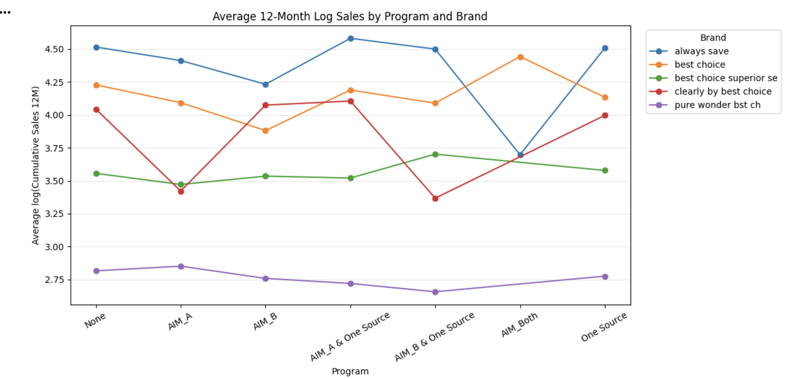

| Brand | Pattern highlighted in the presentation | Evaluation direction |
|---|---|---|
| Always Save | AIM_A & One Source has the highest displayed mean for this brand | Examine the combination with matched brand and store profiles |
| Best Choice | AIM_Both is a prominent peak in the displayed profile | Expand independent store support for this source category |
| Best Choice Superior Selection | AIM_B & One Source has the highest displayed mean for this brand | Prioritize evaluation of that brand-program pairing |
| Clearly by Best Choice | The displayed profile varies across standalone and combined categories | Compare program execution and assortment within this brand |
| Pure Wonder Best Choice | The displayed means follow a relatively compact profile | Combine program evaluation with product and merchandising review |

These brand profiles make program evaluation specific to the product portfolio. Each comparison uses its own brand baseline and sample context.

## 3. Division and program sample structure

Slide 21 provides the store-item observation counts by division and program.

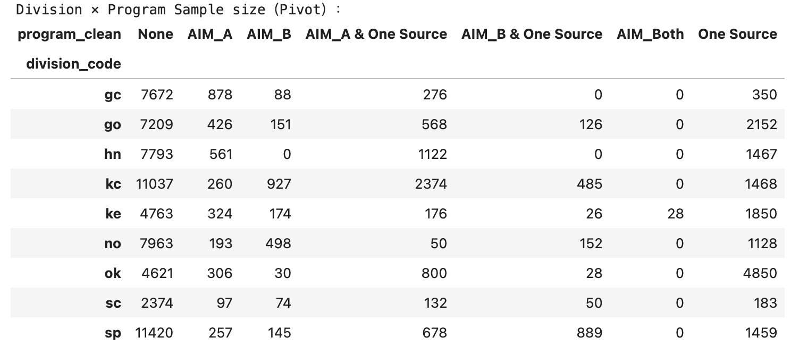

The matrix establishes where program categories are observed and how their sample sizes differ. The portfolio's support tables add distinct-store counts to this observation-level view. That distinction guides sampling priorities and model eligibility.

`AIM_Both` is a separate source label from combined AIM + One Source participation. Its 28 source observations come from one store in the local audit. The follow-up evaluation therefore gives independent-store recruitment an explicit role for this category.

## 4. Nine-division summary

The values below are rounded log-outcome differences shown in slides 22–30, relative to the division's `None` group. The right column describes follow-up evaluation actions.

| Division | Original displayed pattern | Follow-up evaluation |
|---|---|---|
| sc | AIM_B +0.67, One Source +0.42, AIM_A +0.24 | Compare standalone program execution and expand participating-store support |
| hn | AIM_A & One Source +0.06; One Source +0.02 | Evaluate the two participation profiles with matched store characteristics |
| sp | AIM_A & One Source +0.08 | Investigate the integrated auto-ship and merchandising pathway |
| ke | AIM_A & One Source approximately 0.00; One Source −0.03 | Examine store mix, execution, and the relative profile of combined programs |
| no | AIM_A & One Source +0.04 | Add independent stores for this combination and compare exposure histories |
| kc | One Source −0.03; AIM_A & One Source −0.04 | Study baseline store characteristics and product composition |
| go | AIM_A & One Source −0.01; One Source −0.06 | Investigate execution differences and the baseline purchasing profile |
| gc | AIM_A −0.05; AIM_A & One Source −0.10 | Review assortment and store profiles across participation categories |
| ok | AIM_B & One Source +0.50 | Recruit additional stores for this combination and evaluate matched comparisons |

### sc — standalone program comparison

Slide 22. The displayed standalone categories provide the most prominent positive differences in this division.

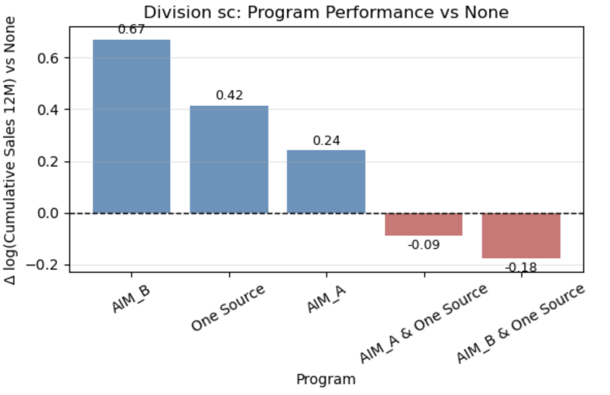

### hn — combined and merchandising profiles

Slide 23. AIM_A & One Source and One Source are the two displayed categories with positive differences.

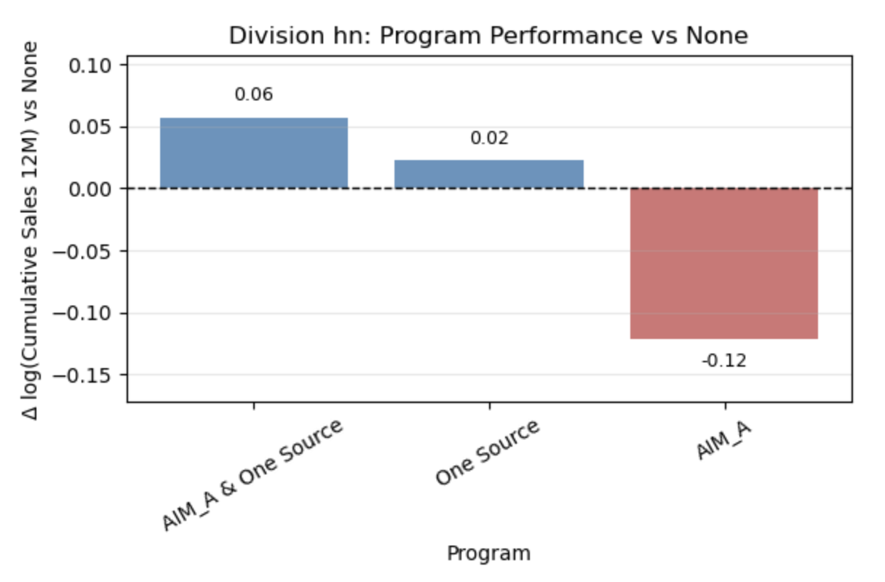

### sp — integrated program pathway

Slide 24. AIM_A & One Source has a displayed difference of approximately +0.08.

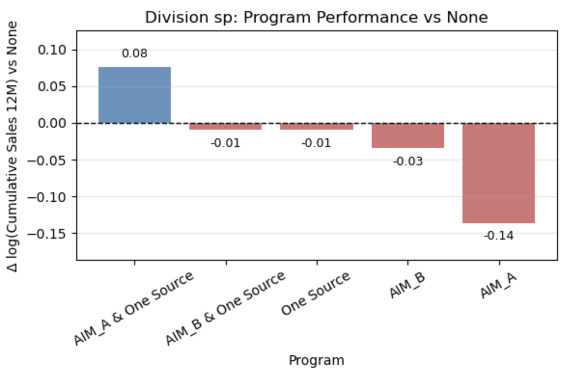

### ke — comparison around the division baseline

Slide 25. The combined AIM_A & One Source profile is close to the baseline, providing a comparison point for the other categories.

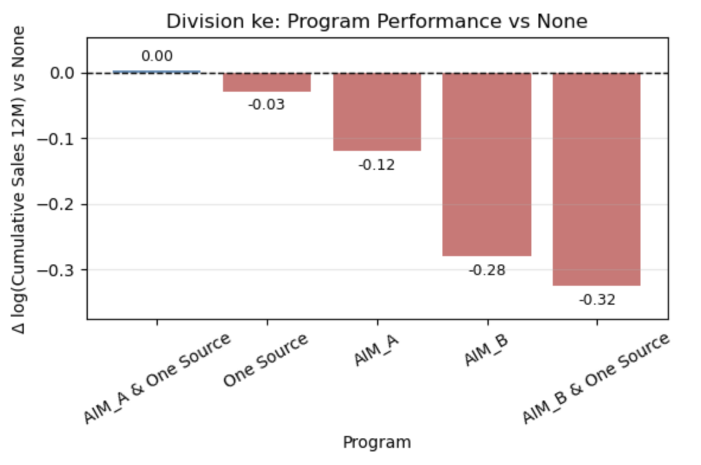

### no — combination-specific evaluation

Slide 26. AIM_A & One Source provides the positive comparison highlighted in the original regional view.

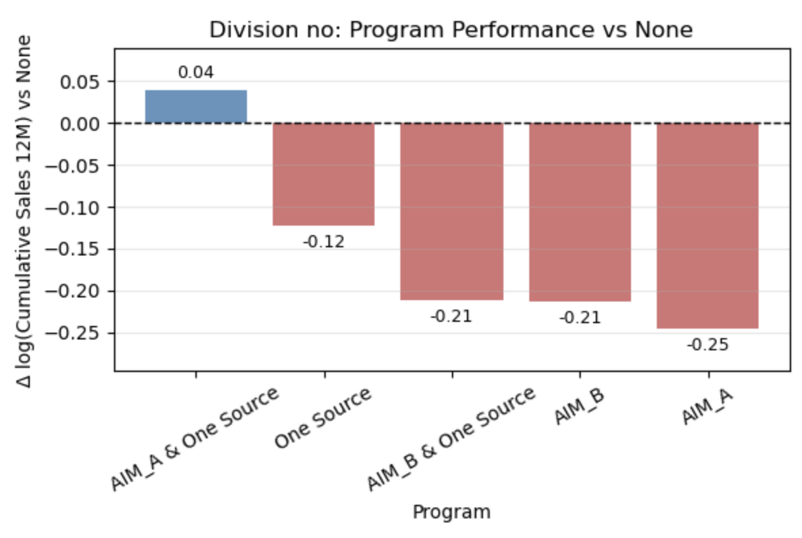

### kc — baseline and product-mix review

Slide 27. The chart supports a focused review of the baseline store profile and the composition of purchasing across program groups.

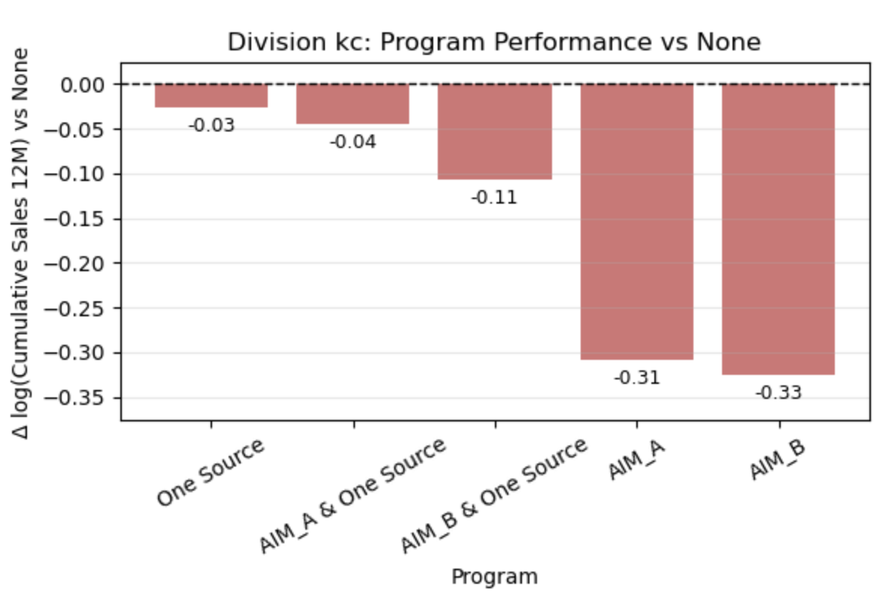

### go — execution and store-profile review

Slide 28. The relative positions of combined and standalone categories provide a basis for reviewing program execution and store selection.

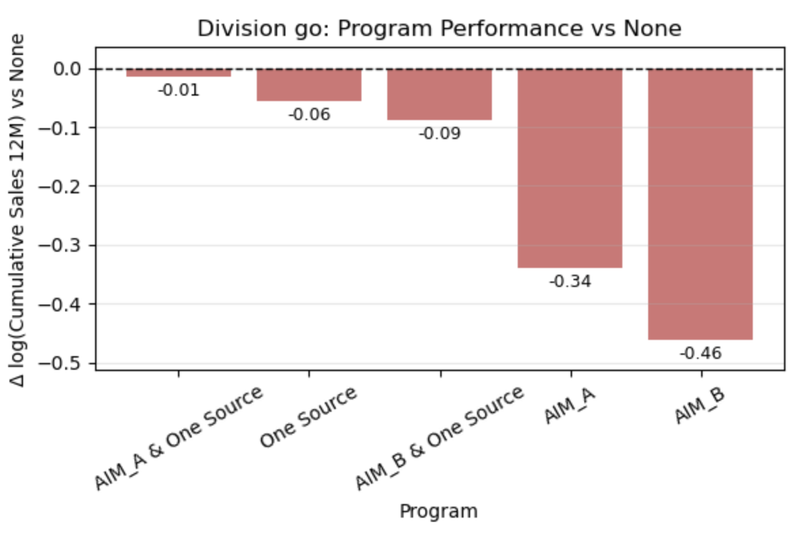

### gc — assortment and participation review

Slide 29. The chart provides a program-specific purchasing profile for further assortment and store-level analysis.

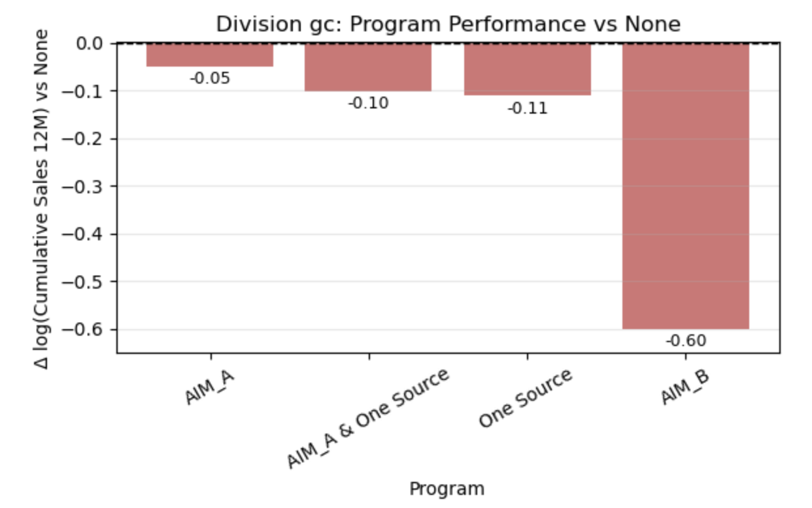

### ok — targeted combination follow-up

Slide 30. AIM_B & One Source has the most prominent positive displayed difference in this division. Independent-store recruitment is a priority for evaluating this combination.

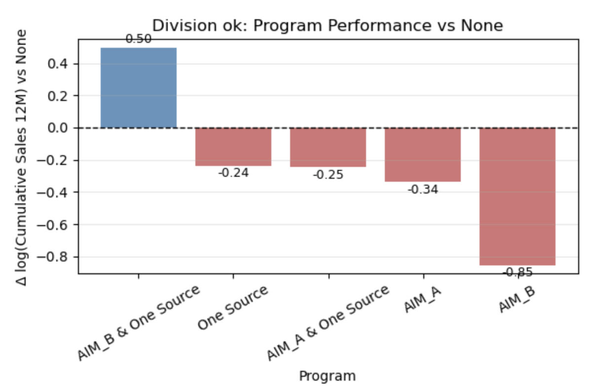

## 5. Recommendations and next steps

Slide 31 organizes recommendations around selective program evaluation, brand fit, and regional allocation. The portfolio develops those themes into an evaluation plan:

- **Match programs to brands.** Prioritize assessment of Best Choice Superior Selection and its AIM_B + One Source profile; evaluate Always Save and Best Choice with their own program patterns.
- **Review product strategy alongside program participation.** Use Pure Wonder and Clearly by Best Choice profiles to guide product, assortment, and merchandising questions.
- **Set division-specific pilot priorities.** Examine the standalone profiles in sc and the integrated profiles in sp, hn, no, and ok, with distinct-store support included in the selection criteria.
- **Investigate operating context.** Add store characteristics, exposure dates, assortment, and execution data for divisions where baseline purchasing is a useful reference.
- **Define pilot outcomes.** Measure first shipment, repeat purchase, purchase-based coverage, and contribution margin after program costs.

## Source and implementation guide

The charts are original embedded presentation assets. The [image manifest](../reports/presentation-excerpts/source_manifest.json) records each slide, source asset, and image hash. The [methodology](methodology.md) describes the original OLS specifications and the subsequent portfolio implementation with support screening and clustered intervals. The [checkpoint notebook](../notebooks/02_checkpoint2_brand_and_division.ipynb) provides the execution edition, with original code in its linked archive; the [execution guide](reproducibility.md) explains local data use.
