# 第二轮成果：品牌与区域分析

[English](checkpoint-2.md) / **简体中文** · [项目首页](../README.zh-CN.md)

本篇按照最终客户汇报 **AWG Program Participation Analysis.pptx 第17–31页**，整理品牌与区域分析的完整主线。原汇报图表展示当时的分析结果，后续评估方向将细分发现转化为具体的研究与试点任务。

## 1. 交互回归方法

第17–18页提出品牌是否调节项目与销售关联的问题，第20页将同一问题扩展至区域。原 notebook 分别建立两组 OLS 回归：

```text
log(1 + 累计m12销售额) ~ C(项目参与类别) * C(品牌)
log(1 + 累计m12销售额) ~ C(项目参与类别) * C(区域)
```

以 `None` 为项目基准组，保留 `None`、`AIM_A`、`AIM_B`、`AIM_A & One Source`、`AIM_B & One Source`、`AIM_Both`、`One Source` 七类标签。结果解释结合项目主效应和交互项，在同一品牌或区域内进行比较。

原分析包括93,108条门店商品观测，覆盖2,736家门店、185个商品、5个品牌和9个区域。品牌模型 R² 为0.051，区域模型 R² 为0.014；因变量沿用源表累计 m12 定义。[完整方法](methodology.md)

## 2. 品牌层面的发现

以下为第19页原品牌分析图。

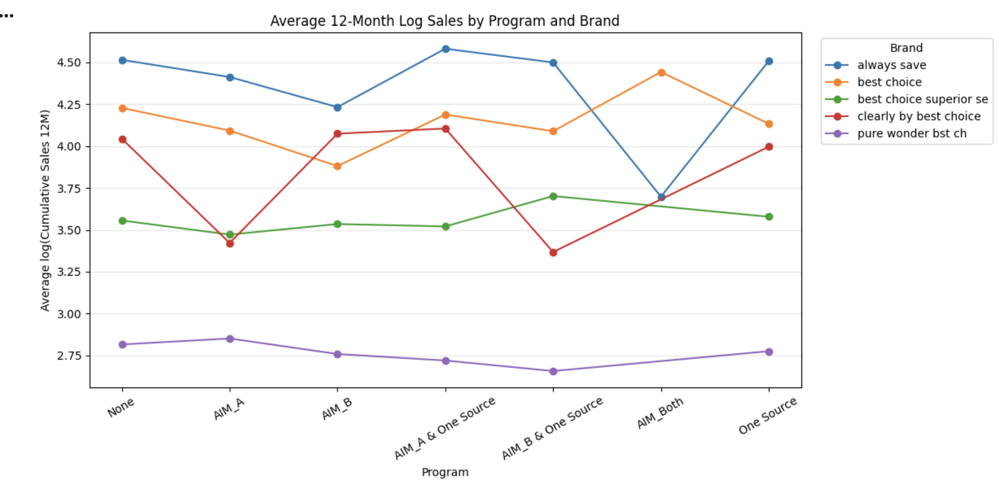

| 品牌 | 原汇报呈现的特征 | 进一步评估方向 |
|---|---|---|
| Always Save | AIM_A & One Source 对应该品牌图中最高均值 | 结合品牌及门店特征评估该组合 |
| Best Choice | AIM_Both 在品牌曲线中形成明显峰值 | 扩充该源类别的独立参与门店样本 |
| Best Choice Superior Selection | AIM_B & One Source 对应该品牌图中最高均值 | 优先评估这一品牌与项目组合 |
| Clearly by Best Choice | 单项目与组合项目呈现各自的变化轨迹 | 结合品牌选品与执行方式开展比较 |
| Pure Wonder Best Choice | 各参与类别的均值分布相对集中 | 将项目评估与产品及陈列策略结合 |

品牌分析将项目评估具体到产品组合。各品牌使用自身基准和样本背景进行解释，为定向试点提供切入点。

## 3. 区域与参与类别的样本结构

第21页提供区域 × 项目参与类别的门店商品观测数。

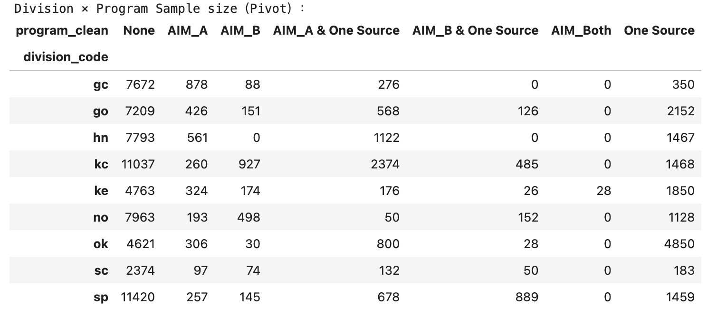

样本矩阵说明各区域具备哪些项目类别及其观测规模。作品集支持表进一步补充独立门店数量，将观测数与独立样本规模同时用于抽样规划和模型资格筛选。

`AIM_Both` 是单独保留的源类别，和 AIM + One Source 组合分别编码。本地核对显示，该类别28条源观测来自一家门店，因此后续评估将扩充独立门店作为明确的样本任务。

## 4. 九个区域的结果汇总

下表数值取自原汇报第22–30页图中标注，为相对同区域 `None` 组的对数结果差值。右侧列出进一步评估动作。

| 区域 | 原汇报呈现的特征 | 后续评估动作 |
|---|---|---|
| sc | AIM_B +0.67、One Source +0.42、AIM_A +0.24 | 比较单项目执行特征，并扩充参与门店样本 |
| hn | AIM_A & One Source +0.06；One Source +0.02 | 结合匹配门店特征评估两类参与方式 |
| sp | AIM_A & One Source +0.08 | 研究自动配货与陈列支持的整合路径 |
| ke | AIM_A & One Source 约0.00；One Source −0.03 | 对比门店结构、执行方式及组合项目特征 |
| no | AIM_A & One Source +0.04 | 补充该组合的独立门店及参与时间信息 |
| kc | One Source −0.03；AIM_A & One Source −0.04 | 研究基准门店特征和商品结构 |
| go | AIM_A & One Source −0.01；One Source −0.06 | 结合执行方式与基准采购画像开展分析 |
| gc | AIM_A −0.05；AIM_A & One Source −0.10 | 对齐参与类别的选品和门店特征 |
| ok | AIM_B & One Source +0.50 | 招募更多组合参与门店并开展匹配比较 |

### sc：单项目比较

第22页。原图中单项目类别呈现较突出的正向差值。

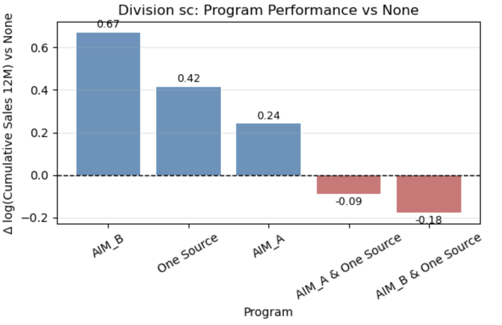

### hn：组合项目与陈列支持

第23页。AIM_A & One Source 与 One Source 是图中呈现正向差值的两类参与方式。

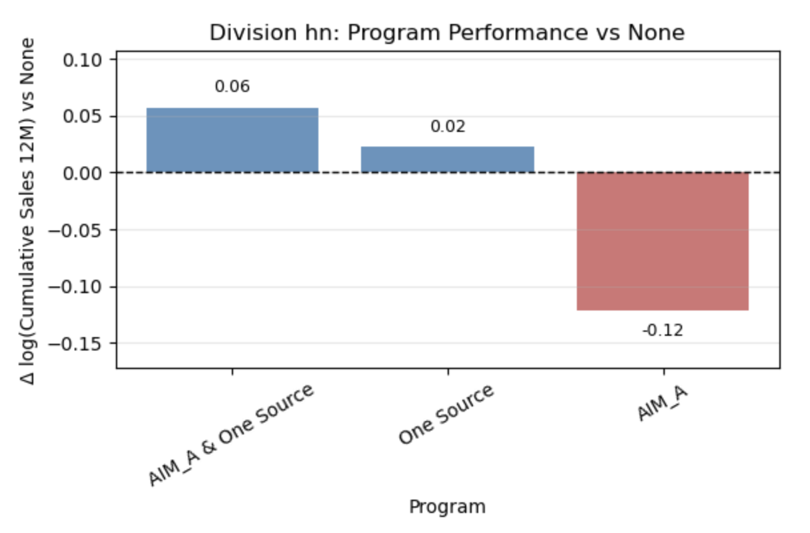

### sp：项目整合路径

第24页。AIM_A & One Source 的图示差值约为+0.08。

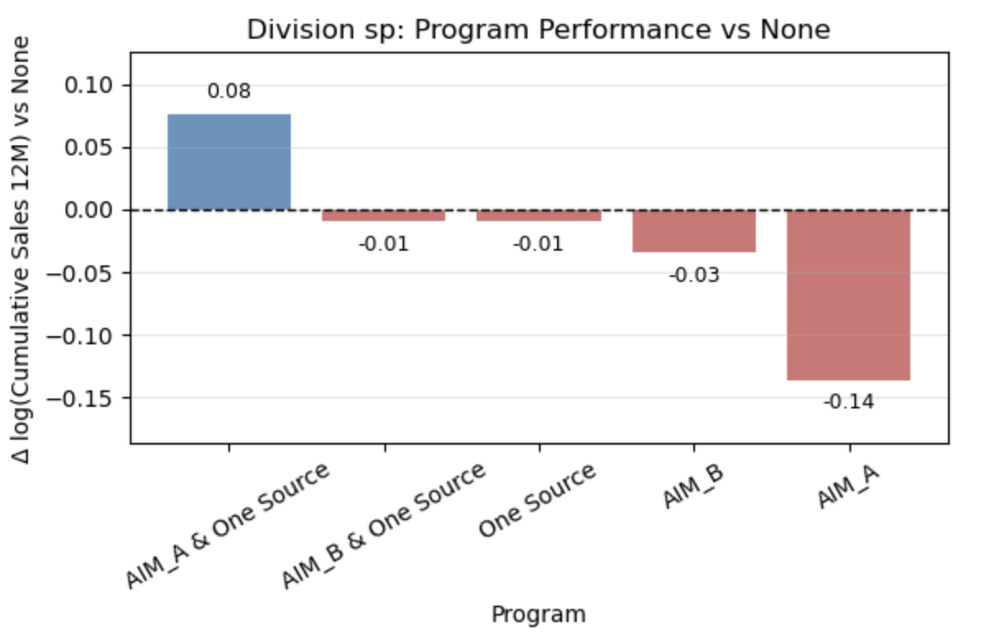

### ke：围绕区域基准开展比较

第25页。AIM_A & One Source 接近区域基准，为其他参与类别提供具体的比较参照。

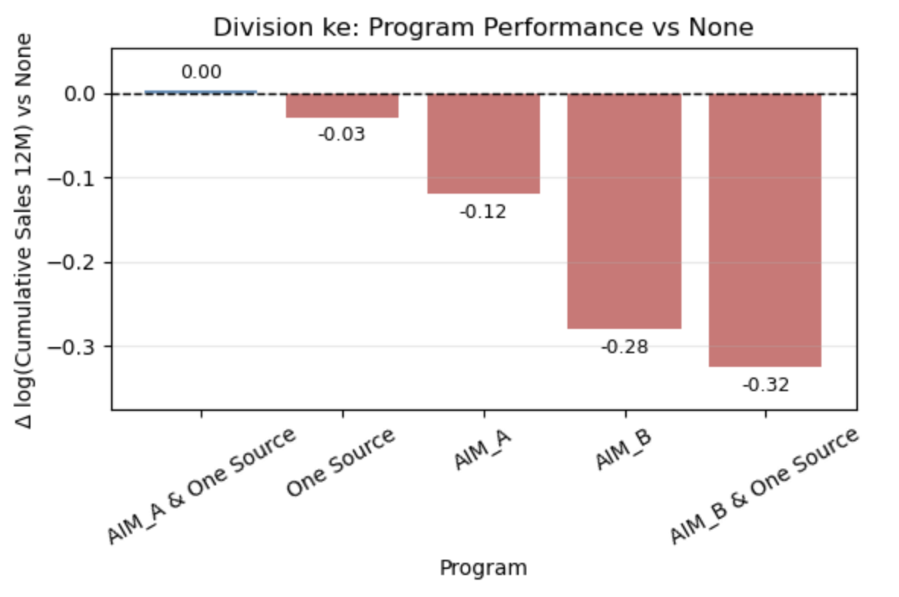

### no：组合类别专项评估

第26页。AIM_A & One Source 是原区域图中重点呈现的正向组合。

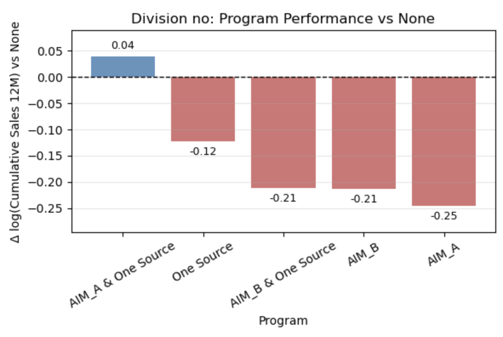

### kc：基准门店与商品结构

第27页。原图为进一步研究基准门店画像、参与类别和采购结构提供具体依据。

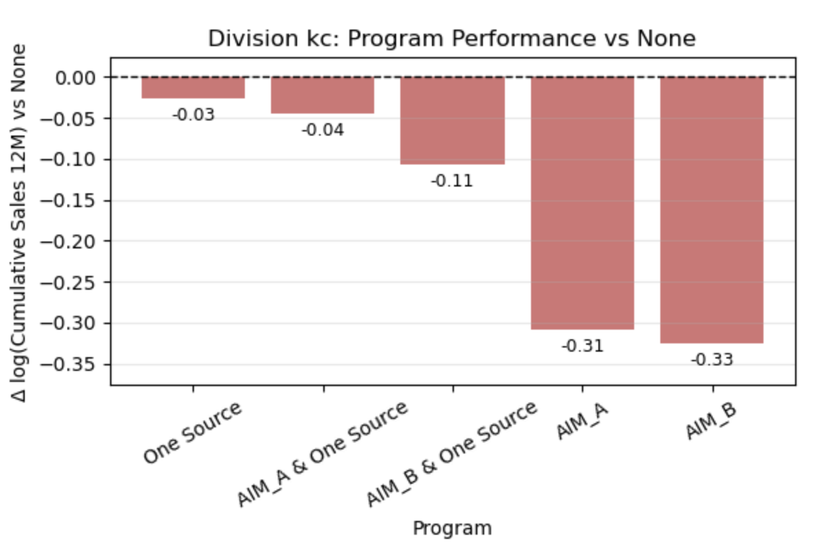

### go：执行与门店画像

第28页。组合项目与单项目的相对位置支持继续分析执行方式和门店选择。

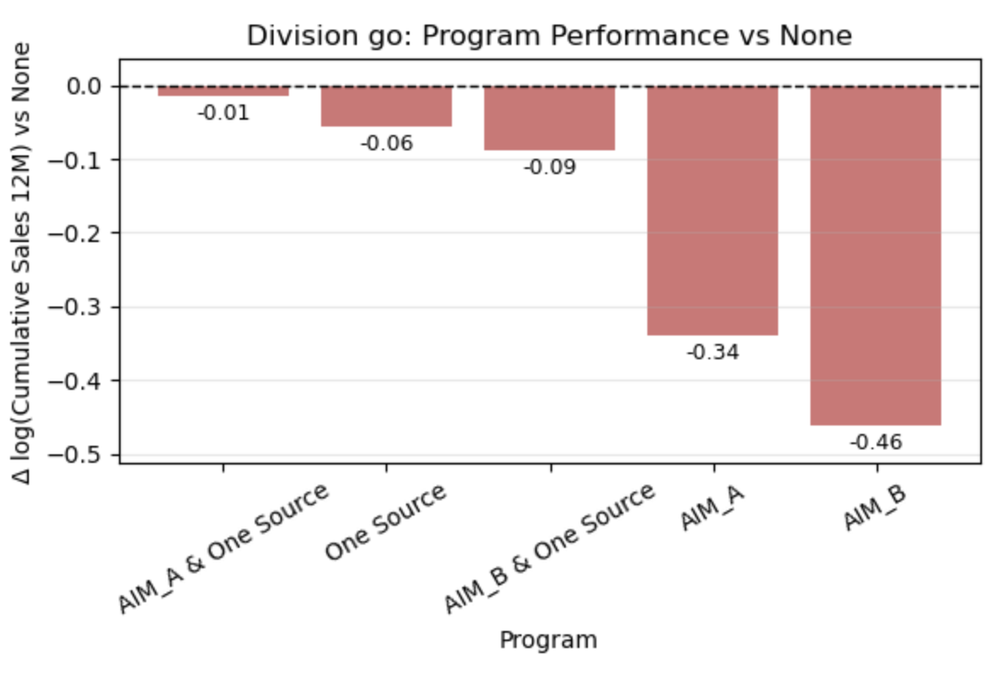

### gc：选品与参与类别

第29页。各参与类别形成区域采购画像，可进一步结合选品和门店数据开展分析。

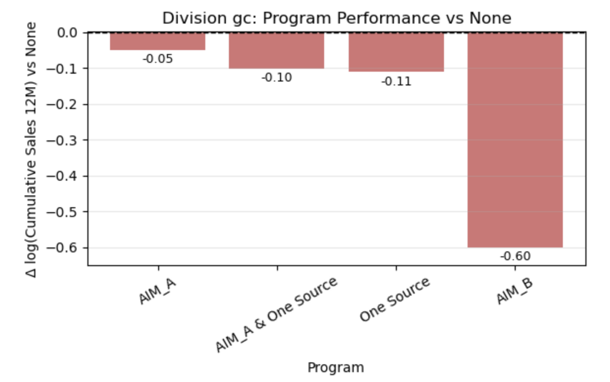

### ok：定向组合评估

第30页。AIM_B & One Source 在原图中呈现突出正向差值，扩充独立门店样本是该组合进一步评估的重点任务。

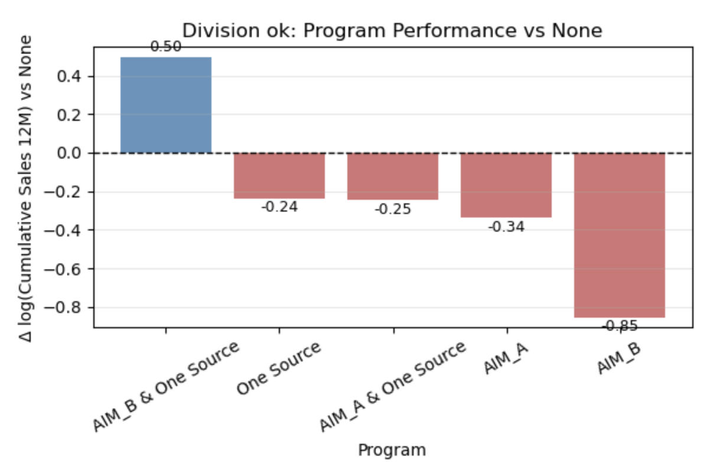

## 5. 建议与后续工作

第31页围绕细分项目评估、品牌匹配及区域资源配置提出建议。作品集将这些主题整理为进一步评估计划：

- **按品牌匹配项目。** 优先评估 Best Choice Superior Selection 与 AIM_B + One Source 的组合，并结合 Always Save 和 Best Choice 的各自参与曲线开展比较。
- **把产品策略纳入评估。** 结合 Pure Wonder 和 Clearly by Best Choice 的曲线研究产品、选品和陈列策略。
- **明确区域试点方向。** 研究 sc 的单项目特征及 sp、hn、no、ok 的整合项目特征，将独立门店支持纳入候选筛选。
- **补充经营环境。** 对齐门店特征、参与时间、选品和执行数据，细化区域采购背景。
- **定义试点结果。** 同时跟踪首次配送、重复采购、采购覆盖率和扣除项目成本后的贡献利润。

## 来源与实现

图表保留原汇报内嵌图像。[图片来源记录](../reports/presentation-excerpts/source_manifest.json)提供每张图的页码、原始资源和哈希。[方法文档](methodology.md)分别介绍原 OLS 规格与作品集的样本筛选、聚类区间实现。[第二轮 notebook](../notebooks/02_checkpoint2_brand_and_division.ipynb)提供运行版，其关联归档保留原始代码，[运行说明](reproducibility.md)介绍本地数据使用方式。
